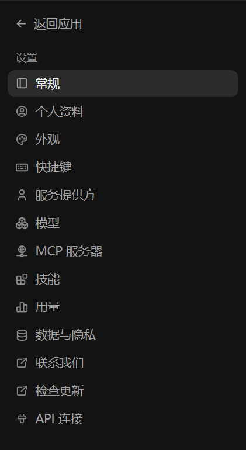

# Carb

**第一次用 Agent，从 Carb 开始。**

Carb 是面向 AI 新手的桌面 AI 工作台。你可以在一个窗口里连接模型、打开本地项目、通过自然语言提出需求、检查文件变更、运行工具，并把任务结果保存为实际文件。

它适合从整理资料、编写报告、制作演示文稿、处理表格或修改一个小项目开始，逐步理解 AI Agent 如何使用工具完成工作。

**当前版本：5.6.13 · Windows x64**

[下载 Windows 安装版](https://github.com/HIUPAC/Carb/releases/download/v5.6.13/Carb-Setup-5.6.13-win-x64.exe) · [下载完整便携包](https://github.com/HIUPAC/Carb/releases/download/v5.6.13/Carb-5.6.13-win-x64-portable.zip) · [本版说明](docs/RELEASE-v5.6.13.md) · [修改日志](CHANGELOG.md) · [联系我们](https://houpac.top/)

本仓库包含 Carb 当前维护代码、5.6.13 发布代码快照、前端资源、10 个内置技能、安装器与许可材料。安装包和完整运行时通过 GitHub Releases 分发。`app/` 是发行包中的 JavaScript／资源快照，当前没有完整原始 TypeScript／TSX 工程；构建条件见下文。文档与发行文件核对日期为 **2026-11-17**。

## 5.6.13 新增内容

在软件「设置」左侧新增两个按钮，点击后使用系统默认浏览器打开对应网页：

| 设置按钮 | 打开网页 | 用途 |
| --- | --- | --- |
| 联系我们 | [houpac.top](https://houpac.top/) | 访问联系页面 |
| 检查更新 | [GitHub Releases](https://github.com/HIUPAC/Carb/releases) | 查看新版本、发行说明和下载文件 |

仓库和官网的软件下载安装入口统一指向 GitHub Releases；版本记录列出每版修改内容，每个附件均记录上传与更新时间。

「检查更新」提供发行页面入口，不会自动下载或安装更新。两个入口均支持中文、日文和英文；网页无法打开时会提示目标地址。已在 5.6.13 实际设置界面验证两个入口，未发现渲染错误。



## 下载 Carb 5.6.13

| 文件 | 用途 | 大小 | 文件上传时间（北京时间 UTC+8） | 文件更新时间（北京时间 UTC+8） |
| --- | --- | --- | --- | --- |
| [Carb-Setup-5.6.13-win-x64.exe](https://github.com/HIUPAC/Carb/releases/download/v5.6.13/Carb-Setup-5.6.13-win-x64.exe) | Windows x64 安装版，适合日常使用 | 163,305,830 字节，约 155.74 MiB | 2026-11-17 13:26:35 | 2026-11-17 13:30:17 |
| [Carb-Setup-5.6.13-win-x64.exe.sha256](https://github.com/HIUPAC/Carb/releases/download/v5.6.13/Carb-Setup-5.6.13-win-x64.exe.sha256) | 安装包 SHA-256 校验值 | 文本文件 | 2026-11-17 13:26:35 | 2026-11-17 13:26:35 |
| [Carb-Setup-5.6.13-win-x64.manifest.json](https://github.com/HIUPAC/Carb/releases/download/v5.6.13/Carb-Setup-5.6.13-win-x64.manifest.json) | 版本、签名状态和载荷文件清单 | JSON 文件 | 2026-11-17 13:26:35 | 2026-11-17 13:26:45 |
| [Carb-5.6.13-win-x64-portable.zip](https://github.com/HIUPAC/Carb/releases/download/v5.6.13/Carb-5.6.13-win-x64-portable.zip) | 完整运行载荷，含 Electron 运行时和所需资源，解压即可运行 | 211,864,824 字节，约 202.05 MiB | 2026-11-17 13:26:35 | 2026-11-17 13:30:40 |
| [Carb-5.6.13-win-x64-portable.zip.sha256](https://github.com/HIUPAC/Carb/releases/download/v5.6.13/Carb-5.6.13-win-x64-portable.zip.sha256) | 便携包 SHA-256 校验值 | 文本文件 | 2026-11-17 13:26:35 | 2026-11-17 13:26:35 |

上传与更新时间分别来自 GitHub Release 附件的 `created_at` 和 `updated_at`，均换算为北京时间（UTC+8）。各历史版本的包、时间和修改内容见 [版本与修改记录](#版本与修改记录)。

安装包 SHA-256：`8fc61bcf3f6764ebfb41f0554e7a5c6cf160b1e1cf589a98eda497780d5121be`。

便携包 SHA-256：`b7d38dc360e44ed97159c33aaa544db9d530f966b78b4d6e204bc1fb562b528f`。

在 [v5.6.13 Release](https://github.com/HIUPAC/Carb/releases/tag/v5.6.13) 可查看全部发行文件。GitHub 自动生成的 **Source code** 压缩包仅包含仓库文件；运行 Carb 请下载上表中的安装版或完整便携包。安装和校验步骤见下文。

## 目录

- [5.6.13 新增内容](#5613-新增内容)
- [下载 Carb 5.6.13](#下载-carb-5613)
- [软件特点](#软件特点)
- [功能模块](#功能模块)
- [运行条件与平台](#运行条件与平台)
- [安装 Carb](#安装-carb)
- [通过 Git 拉取与更新仓库](#通过-git-拉取与更新仓库)
- [第一次使用](#第一次使用)
- [文件处理与成果交付](#文件处理与成果交付)
- [内置技能与技能安装](#内置技能与技能安装)
- [数据存储与权限](#数据存储与权限)
- [更新与卸载](#更新与卸载)
- [维护工作区与构建](#维护工作区与构建)
- [常见问题](#常见问题)
- [版本与修改记录](#版本与修改记录)
- [反馈与贡献](#反馈与贡献)
- [开源许可证与第三方条款](#开源许可证与第三方条款)

## 软件特点

- **围绕本地项目工作**：选择自己的文件夹，让对话、文件查看、变更审查和终端操作围绕同一项目展开。
- **连接不同模型服务**：通过 API 连接或独立 CLI 使用模型，按任务选择连接方式与模型。
- **从聊天走向任务执行**：借助所选 Agent 及其工具读取资料、修改文件、执行命令，查看进度并处理授权请求。
- **保留可检查的成果**：输出实际文件，提供文件位置、打开方式及部分工作流中的回读校验，方便继续编辑和交付。
- **通过技能扩展流程**：使用内置技能，或从本地 ZIP、文件夹安装其他技能，为设计、编程、演示文稿等任务提供指导。
- **适应日常桌面使用**：提供亮色／暗色主题、中文字体设置、用户头像与资料设置。

Carb 本身不附带通用大模型。模型账号、API 密钥、网络访问、额度及相关工具需要按所选连接方式准备；模型服务可能另行收费。

## 功能模块

| 模块 | 主要用途 | 使用说明 |
| --- | --- | --- |
| 项目与对话 | 打开本地目录，在项目上下文中提出需求和继续任务 | 建议先选择范围明确的项目文件夹 |
| API 连接 | 设置服务商、协议、基础地址、密钥和默认模型 | 支持 OpenAI Chat Completions、OpenAI Responses、Anthropic Messages 协议 |
| 服务提供方与 CLI | 检查 CLI 安装状态、登录账号并选择模型 | 具体能力取决于服务提供方和独立 CLI |
| 文件（Files） | 浏览项目文件、查看内容及定位成果 | 文件访问受实际目录、工具能力与授权约束 |
| 变更审查（Review） | 查看文件差异，检查 Agent 修改了什么 | 对重要内容应在使用前自行复核 |
| 终端（Terminal） | 在项目中运行命令，查看命令输出 | 命令会影响实际环境，按授权提示操作 |
| 浏览器（Browser） | 查看页面，辅助网页任务与检查 | 可用行为取决于当前 Agent 和工具配置 |
| 临时聊天（Temporary chat） | 发起临时对话 | 按当前界面提示使用 |
| 子智能体（Agents） | 查看或使用 Agent 协作入口 | 是否支持及如何执行取决于服务提供方 |
| 文档任务 | 根据项目文本和任务要求创建 Markdown 文档 | 专用入口当前只输出新的 `.md` 文件 |
| 成果交付 | 整理输出文件，提供打开、定位和复制路径等操作 | Office 文件的查看需要相应应用 |
| 技能管理 | 查看、安装、启停和删除技能 | 当前仅接受本地 ZIP 或技能文件夹 |
| MCP 设置 | 配置项目或服务提供方相关的外部工具连接 | 需要相应 MCP 服务和服务提供方支持 |
| 外观与用户资料 | 设置主题、中文字体、名称和头像 | 字体预设使用本机已安装字体 |
| 手机连接设置 | 提供连接开关、二维码配对和设备管理 | 当前未验证完整手机端连接流程，不能据此视为开箱可用的移动端能力 |
| 联系我们 | 在默认浏览器打开 [联系页面](https://houpac.top/) | 设置左侧按钮，5.6.13 新增 |
| 检查更新 | 在默认浏览器打开 [发行页面](https://github.com/HIUPAC/Carb/releases) | 查看并手动下载更新，5.6.13 新增 |

## 运行条件与平台

本文的安装步骤适用于 **Windows x64 安装版 5.6.13**。

普通用户运行桌面软件，无需单独安装用于开发 Carb 的 Node.js。但不同任务可能需要额外条件：

| 使用场景 | 需要准备 |
| --- | --- |
| API 对话 | 可访问的服务地址、有效密钥、可用模型及额度 |
| CLI Agent | 相应独立 CLI、账号认证及该工具要求的运行环境 |
| 查看 Word／PowerPoint／Excel 成果 | Office、WPS 或其他兼容应用 |
| 运行 Python 或其他脚本 | 对应解释器和项目依赖 |
| 视频、语音等技能 | 技能指定的工具、转录服务或硬件权限 |
| Windows 本地图片 OCR | 系统已安装的相应 OCR 语言组件 |

请为安装程序、约 411 MiB 的当前应用载荷、缓存及项目成果预留磁盘空间。当前核查未确认统一的最低 Windows 版本或最低内存要求，因此不提供未经测试的兼容承诺。

本次 Release 仅发布 Windows x64 5.6.13。历史本地工作区另有 macOS 5.6.10 ad-hoc 预览包和 Android 5.6.10 独立客户端，它们未纳入本次发行，也不能等同于桌面版功能。当前没有在此发布 Linux 包。

## 安装 Carb

### 1. 获取安装包

打开 [v5.6.13 Release](https://github.com/HIUPAC/Carb/releases/tag/v5.6.13)，下载：

```text
Carb-Setup-5.6.13-win-x64.exe
Carb-Setup-5.6.13-win-x64.exe.sha256
Carb-Setup-5.6.13-win-x64.manifest.json
```

安装包大小为 **163,305,830 字节，约 155.74 MiB**。请同时取得对应的校验文件，并在安装前核对摘要。

需要解压使用时，可下载同一 Release 中的 `Carb-5.6.13-win-x64-portable.zip`，核对其 `.sha256` 后解压，再运行 `Carb-5.6.13/Carb.exe`。便携包表示无需安装向导，**不表示资料完全保存在解压目录**；默认会话、配置等路径仍见「数据存储与权限」。

### 2. 校验文件

在安装包所在目录打开 PowerShell：

```powershell
Get-FileHash .\Carb-Setup-5.6.13-win-x64.exe -Algorithm SHA256
```

当前核实的 SHA-256 为：

```text
8fc61bcf3f6764ebfb41f0554e7a5c6cf160b1e1cf589a98eda497780d5121be
```

摘要用于确认文件与该版本一致。当前安装包**未进行数字签名（NotSigned）**；摘要不能代替对下载来源的确认。

### 3. 运行安装向导

1. 双击 `Carb-Setup-5.6.13-win-x64.exe`。
2. 选择安装语言；向导提供简体中文、英语和日语。
3. 选择安装目录。默认位置为 `%LocalAppData%\Programs\Carb`。
4. 按需勾选创建桌面快捷方式；该选项默认未勾选。
5. 完成安装，从开始菜单中的 **Carb** 或安装结束后的启动选项打开软件。

默认按当前用户安装，通常无需管理员权限。主程序为 `Carb.exe`，发布者显示名称为 **冰轮**，Windows 应用 ID 为 `Icewheel.Carb`。

## 通过 Git 拉取与更新仓库

GitHub 仓库：[HIUPAC/Carb](https://github.com/HIUPAC/Carb)。安装 Git 后执行：

```powershell
git clone https://github.com/HIUPAC/Carb.git
Set-Location .\Carb
```

之后在仓库目录中更新：

```powershell
git status
git pull --ff-only
```

如有本地修改，应先保存或提交；出现分支分歧时，先处理分歧，再更新。

**拉取代码与安装桌面软件是不同的操作。** EXE、完整 Electron 运行时和原生依赖位于 Release，不写入普通 Git 历史。`git pull` 不会更新已安装软件。

若需要从仓库准备可运行载荷，在 Windows PowerShell 7 中执行：

```powershell
pwsh -File .\scripts\prepare-payload.ps1
& .\.build\Carb-5.6.13\Carb.exe
```

准备脚本会按 [发行清单](release/windows-x64.json) 下载便携包、校验 SHA-256，再解压到 `.build`；已有目标时拒绝覆盖。也可用 `-ArchivePath` 指定已下载的 ZIP，详见 [构建与运行说明](docs/BUILD.md)。

仓库不提供原始工程的 `npm run dev`／完整 TypeScript 构建命令。`npm run check` 只验证本仓库快照及文档完整性，不启动模型任务。

## 第一次使用

### 1. 准备一个项目文件夹

创建一个用于练习的文件夹，放入几份不含敏感信息的文本资料，然后在 Carb 中添加或打开该目录。

建议把原始资料与输出文件分开放置，例如：

```text
我的第一个项目/
├─ 资料/
│  ├─ 背景说明.md
│  └─ 会议记录.txt
└─ 输出/
```

### 2. 连接模型

可以选择 API 或独立 CLI 方式，按实际需要配置其中一种。

**方式 A：API 连接**

1. 打开「API 连接」，添加连接。
2. 填写显示名称，选择服务商预设和 API 协议。
3. 填写基础地址、API 密钥，启用并保存。
4. 刷新模型列表；服务不提供模型列表时，可手动填写模型 ID。
5. 设置默认模型，选择项目后创建对话。

支持的协议为 **OpenAI Chat Completions、OpenAI Responses、Anthropic Messages**。协议名称表示接口兼容方式，不表示所有服务都支持相同的工具调用、图片或模型列表功能。

基础地址需要使用 HTTPS；本机服务可使用 `http://127.0.0.1`。可选的模型列表地址必须与基础地址同源。地址、协议和模型 ID 应以服务商说明为准。

**方式 B：独立 CLI**

1. 在「服务提供方」中检查所需 CLI 的安装状态、版本及路径。
2. 按界面提示安装或选择已有 CLI。
3. 完成相应账号登录，再选择模型并创建对话。

Carb 会识别独立 CLI。以 Codex 为例，安装 Codex 桌面客户端，不等于已安装可供 Carb 使用的独立 Codex CLI；桌面客户端内部的私有 CLI 或 daemon 也不能替代它。

如登录需要外部浏览器，按界面完成授权；浏览器未成功打开时，可以从登录面板复制授权链接继续操作。账号权限和订阅是否可用于相应 API／CLI，以服务商政策为准。

### 3. 提出明确的任务

可以从下面的需求开始：

```text
请阅读“资料”文件夹里的 Markdown 和文本文件，整理一份项目概览。
包含背景、主要事项、待确认问题和下一步行动。
保留来源文件名，不编造资料中没有的信息。
将结果保存为“输出/项目概览.md”，不要覆盖已有文件。
```

提供输入位置、目标格式、输出位置和验收要求，通常比只说“帮我做一下”更容易得到可检查的结果。

### 4. 查看执行过程并检查结果

留意 Agent 的进度、工具调用和授权请求。涉及命令运行或文件修改时，先确认操作范围；需要调整方向时可以中断任务，再补充说明。

任务结束后，检查文件是否实际生成、保存位置是否正确、内容是否符合资料，以及是否发生预期外的变更。对涉及代码的任务，可结合 Review 和终端继续验证。

## 文件处理与成果交付

### 专用「文档任务」入口

该入口当前用于**创建 Markdown 文档**：选择项目、API 连接和模型，填写任务、角色及验收标准，指定新的 `.md` 文件名后运行。

此流程读取项目文本并生成新文件，执行文件回读验证；该入口不执行 shell，也不覆盖已有文件。它不能直接作为 Word、PowerPoint 或 Excel 导出入口。

### 普通 Agent 与文件成果

普通 Agent 可在模型、技能和工具支持的前提下处理更多格式。当前工作区包含 **DOCX、PPTX、XLSX、Python 和 Markdown** 五类成果的交付与验收流程。

例如，可以要求 Agent 根据资料制作可编辑演示文稿，并按需使用 `ppt-master` 技能；也可以要求整理表格或编写脚本。最终能否完成，取决于模型工具能力、已安装依赖、任务内容和授权。

成果区域可提供打开文件、打开所在文件夹、在文件夹中显示及复制绝对路径等操作。Word／PowerPoint／Excel 通常交给系统默认的 Office 或 WPS 等应用打开；脚本类成果不会提供直接运行式的打开操作，可先定位到目录或用编辑器检查。

部分流程会提供真实文件回读及 SHA-256 回执。**文件存在、摘要一致或格式结构通过检查，不代表内容正确，也不代表 Office 页面的视觉排版已经验收。** 最终交付前应打开成果检查。

### 图片、OCR 与语音

- 图片理解需要所选模型支持视觉，或配置相应工具。
- Windows 本地 OCR 用于从图片提取文字，依赖系统 OCR 语言；它不能替代对布局、颜色和物体的理解，也不等同于完整 PDF OCR 流程。
- 语音技能需要麦克风权限及已配置的转录服务；不能视为内置的通用离线语音引擎。

## 内置技能与技能安装

技能由说明、提示和可选脚本等组成，用于指导 Agent 按某种流程工作。技能本身不是模型，也不会自动补齐外部服务、工具或运行环境。

### 当前内置的 10 个技能

| 技能标识 | 主要用途 | 条件或边界 |
| --- | --- | --- |
| `request-optimizer` | 优化用户输入草稿 | 用户决定是否应用，不自动发送 |
| `program-ui-design` | 桌面、Web 和移动端界面设计 | 提供设计流程与检查要求 |
| `image-recognition` | 图片检查与 OCR 辅助 | 需要模型视觉能力或可用 OCR 工具 |
| `voice-input` | 语音转录、整理与成稿 | 需要麦克风权限及转录服务 |
| `trae-programming` | 按项目上下文进行编程与验证 | 属于工作流，不代表安装了 Trae |
| `workbuddy-agent` | WorkBuddy 适配与使用指引 | 须先验证本地程序、协议和认证；WorkBuddy 与 CodeBuddy 不应混用 |
| `design-taste-frontend` | 前端视觉设计与浏览器检查 | 需要相应项目和工具环境 |
| `ppt-master` | 可编辑 PowerPoint 制作与改进 | 需要相应脚本和依赖 |
| `cinetic` | 代码动效与视频制作 | 按技能说明准备 Node.js、ffmpeg、Python 等依赖 |
| `cook` | 根据参照素材反复构建和检查 | 执行仍受当前会话、工具和运行条件约束 |

### 安装其他技能

当前版本只支持**本地 ZIP 或本地技能文件夹导入**：

1. 从可信来源下载技能 ZIP，或准备包含 `SKILL.md` 的本地文件夹。
2. 打开技能管理，选择本地 ZIP 或文件夹。
3. 查看发现的技能、名称与说明，选择需要安装的项目。
4. 确认安装，再根据任务启用和使用。

`SKILL.md` 需要提供有效的 YAML 元信息，包括 `name` 和 `description`。导入前会预览与校验；重名技能不会直接覆盖，批量安装失败时会回滚。

技能按全局范围安装，不要求先选择项目。可以在管理界面启停、打开位置或删除。不要同时启用大量无关技能。

**当前不能直接粘贴 GitHub URL 安装技能。**「浏览 Find Skill」会打开外部页面；需要先下载到本地，再通过 ZIP 或文件夹导入。旧版说明中关于远程链接导入的描述不适用于当前版本。

## 数据存储与权限

默认路径如下：

| 内容 | 默认位置 |
| --- | --- |
| 程序文件 | `%LocalAppData%\Programs\Carb` |
| 桌面用户资料，包括会话、设置和缓存等 | `%APPDATA%\CarbData` |
| 产品配置目录 | `%USERPROFILE%\.carb`，即 `~/.carb` |
| 桌面默认全局技能目录 | `%APPDATA%\CarbData\skills` |
| 项目原文件与成果 | 用户选择的项目目录及任务指定的输出位置 |

高级配置可通过 `CARB_DATA_DIR`／`HARNESS_DATA_DIR` 等改变数据路径；`CARB_GLOBAL_SKILLS_DIR` 可指定全局技能绝对路径。独立运行后端且未指定数据目录时，技能目录可回退至 `~/.carb/skills`。自定义路径应按实际运行配置检查。

Carb 不会自动导入或迁移其他产品的数据。需要备份时，请退出应用，再备份自己的项目目录及实际使用的 Carb 数据／配置目录；包含账号或凭据的备份应妥善保管。

本地项目并不意味着处理过程完全离线。发送给远程模型或外部工具的内容会由所选服务处理。请根据任务选择文件范围，确认授权请求，并避免在公开反馈中粘贴密钥、令牌或未脱敏资料。

本文未对全部凭据存储链路进行审计，因此不作“所有密钥均已加密存储”或“数据绝不离开本机”等保证。

## 更新与卸载

### 更新

Carb 5.6.13 可在「设置 → 检查更新」打开 [GitHub Releases](https://github.com/HIUPAC/Carb/releases)，查看最新版本和对应说明。此按钮只打开网页，不会自动下载安装。

1. 在发行页阅读版本说明，下载需要的安装包和对应 `.sha256`。
2. 校验 SHA-256，并备份重要项目和实际使用的 Carb 资料目录。
3. 退出正在运行的 Carb，再运行新版安装向导；更新无需先卸载旧版。
4. 使用便携包时，将新版完整 ZIP 解压到新的目录，再运行其中的 `Carb.exe`。默认资料仍位于用户数据目录，更新前同样需要备份。

如果窗口已关闭但应用仍驻留托盘，请从托盘菜单退出。`git pull` 只更新仓库文件；当前不依赖上游自动更新通道。不同版本间的数据迁移应以实际发行说明为准。

### 卸载

**当前卸载程序会永久删除默认 Carb 用户资料，包括本地设置、会话、凭据和缓存。请在卸载前备份需要保留的内容。**

确认备份后，可从 Windows「设置 → 应用 → 已安装的应用」找到 Carb 并执行卸载，按确认提示完成。

卸载会清理默认 `%APPDATA%\CarbData` 等 Carb 资料与相关注册表项。用户另行选择的项目目录与默认应用资料目录不同；通过环境变量指定的自定义数据目录也需要另行核查，不能假定所有路径都会被清理。

## 维护工作区与构建

仓库主要目录如下：

```text
Carb/
├─ README.md                        # 产品、安装与使用说明
├─ LICENSE / NOTICE                 # Apache-2.0 与上游署名
├─ THIRD_PARTY_NOTICES.md            # 第三方组件说明
├─ THIRD_PARTY_LICENSES.txt          # 第三方许可全文
├─ app/
│  ├─ asar/                         # 当前主进程、preload、@harness 业务发布代码
│  ├─ resources/web/                # 当前前端发布资源
│  ├─ resources/default-skills/     # 10 个内置技能与资源
│  └─ snapshot-manifest.json        # 快照文件摘要与来源
├─ carb-work/
│  ├─ overlay/                     # 当前维护覆盖代码
│  ├─ tools/                       # 品牌准备、校验与重打包工具
│  ├─ installer/                   # Inno Setup 安装器及语言文件
│  ├─ branding/                    # 品牌图标与资源
│  └─ payload-metadata/            # 品牌清单
├─ maintenance/                    # 原 ASAR 重建工具
├─ scripts/                        # 载荷准备与仓库校验
├─ release/                        # 版本、URL、SHA-256 与文件 manifest
├─ licenses/                       # 第三方许可及来源记录
├─ docs/                           # 构建与许可范围说明
└─ .github/                        # 问题模板、PR 模板及完整性检查
```

`app/` 是从当前 5.6.13 发行包导出的发布代码，不是恢复出的原始 TS／TSX 工程。第三方运行依赖与部分外置资源保留在完整 Release 载荷中，具体范围见 [代码快照说明](app/README.md)。

当前原维护链使用「指定旧基包 + overlay + 品牌处理 + 校验 + 安装包」重打包。部分脚本仍依赖原机器路径、指定基包、Inno Setup 及验收运行时；直接克隆不能保证运行所有历史构建与测试。

- 获取并校验可运行载荷：见 [docs/BUILD.md](docs/BUILD.md)。
- 旧基包的暂存与验证方式：见 [carb-work/README.md](carb-work/README.md)。
- 校验仓库快照：安装 Node.js 22 或更高版本后执行 `npm run check`，无需安装 npm 依赖。
- 原始维护工具已保留；编辑 JS 后还需要正确重建 ASAR 并更新 EXE 内的完整性信息，不能只复制文件后宣称构建成功。

## 常见问题

### 拉取仓库后为什么没有程序？

Git 仓库存放维护代码、发布代码快照和资源；安装包及完整运行时在 [Releases](https://github.com/HIUPAC/Carb/releases)。请下载发行包，或执行载荷准备脚本。

### API 连接失败或模型列表为空怎么办？

核对协议、基础地址、密钥权限、网络、额度和模型 ID。模型列表接口可能与推理接口能力不同，必要时手动填写服务商提供的模型 ID。自定义模型列表地址需要同源。

### 已安装 Codex 桌面版，为什么仍提示需要 CLI？

Carb 需要可识别的独立 Codex CLI。检查服务提供方页面显示的路径和版本，按提示安装或选择独立 CLI，再完成认证。

### 为什么文档任务不能生成 `.docx`、`.pptx` 或 `.xlsx`？

专用文档入口只生成新 Markdown 文件。其他格式应使用普通 Agent，并配置相关技能及生成工具，完成后再打开检查。

### 技能导入失败怎么办？

先确认选择的是本地 ZIP 或文件夹，包含有效 `SKILL.md`，且未与已安装技能重名。损坏、加密、ZIP64 或包含不受支持条目的压缩包可能被拒绝；按界面错误提示整理后重试。

### 图片识别、语音或视频任务为什么不能直接运行？

相应技能提供工作流程，执行还需要模型能力、系统 OCR 语言、转录服务或 ffmpeg 等依赖。检查所选技能说明与工具可用状态。

### 成果文件无法打开怎么办？

先定位文件，确认文件真实存在且不是空文件，再检查系统是否安装兼容应用。脚本应先用编辑器检查；结构检查通过也不能保证生成内容完整有效。

### 中文字体与预期不同怎么办？

字体预设使用系统已安装字体，不会自动下载。安装所需字体或换用本机可用字体，分别检查亮色和暗色主题下的设置。

## 版本与修改记录

| 版本 | Release 发布时间（北京时间 UTC+8） | 修改内容 | 安装包与完整便携包 | 发行说明与逐文件上传时间 |
| --- | --- | --- | --- | --- |
| 5.6.13 | 以 GitHub Release 页面时间为准 | 设置新增「联系我们」「检查更新」网页按钮，支持中／日／英与打开失败提示；更新发行快照与校验资料，统一仓库与官网下载入口并记录附件上传时间 | [安装包](https://github.com/HIUPAC/Carb/releases/download/v5.6.13/Carb-Setup-5.6.13-win-x64.exe) · [便携包](https://github.com/HIUPAC/Carb/releases/download/v5.6.13/Carb-5.6.13-win-x64-portable.zip) · [全部附件](https://github.com/HIUPAC/Carb/releases/tag/v5.6.13) | [5.6.13 说明](docs/RELEASE-v5.6.13.md) |
| 5.6.12 | 2026-11-17 11:55:16 | 首次在本 GitHub 仓库整理发布 Windows 安装版、完整便携包和维护快照 | [安装包](https://github.com/HIUPAC/Carb/releases/download/v5.6.12/Carb-Setup-5.6.12-win-x64.exe) · [便携包](https://github.com/HIUPAC/Carb/releases/download/v5.6.12/Carb-5.6.12-win-x64-portable.zip) · [全部附件](https://github.com/HIUPAC/Carb/releases/tag/v5.6.12) | [5.6.12 说明](docs/RELEASE-v5.6.12.md) |

完整修改记录见 [CHANGELOG.md](CHANGELOG.md)；其他历史文件见 [全部 Releases](https://github.com/HIUPAC/Carb/releases)。

## 反馈与贡献

可通过软件「设置 → 联系我们」或直接访问 [联系页面](https://houpac.top/)。

联系方式：QQ：3537963521；微信：IUPAC2816。

可以在 [GitHub Issues](https://github.com/HIUPAC/Carb/issues) 反馈问题或提出改进建议。请尽量提供：

- Carb 版本、Windows 版本及所用连接方式。
- 可复现的操作步骤、期望结果和实际结果。
- 脱敏后的错误信息、截图或日志片段。
- 涉及文件任务时，提供不含隐私的最小示例。

请勿提交 API 密钥、访问令牌、账号凭据或整个用户资料目录。提交修改前请阅读 [贡献指南](CONTRIBUTING.md)。当前没有完整原始 TS／TSX 工程；涉及主程序或安装器的修改，请同时说明运行环境、重打包方式和验证结果。

## 开源许可证与第三方条款

### 仓库与发行包的许可范围

本仓库以根目录 [Apache License 2.0](LICENSE) 作为 Carb 所继承主程序的许可依据，并在 [NOTICE](NOTICE) 中保留 TasteCode 上游及 `Copyright 2026 TasteCode contributors` 署名。第三方组件、技能和资源遵循各自许可。

此前 Gitee 仓库已有文件采用 MIT、版权声明为 `Copyright (c) 2026 冰轮`；其原文作为 [来源记录](licenses/gitee-repository-MIT.txt) 保留。它不会替代本仓库继承的 Apache-2.0 义务，也不会重许可第三方代码。

完整范围与再分发说明见 [docs/LICENSING.md](docs/LICENSING.md)。

### 主要组件及许可

| 范围或组件 | 许可证／条款 |
| --- | --- |
| 原 Gitee 仓库已有文件的许可记录 | MIT，仅适用于对应内容 |
| 发行包所继承的主程序 | Apache-2.0，保留 TasteCode NOTICE |
| Electron | MIT |
| React、React DOM、xterm、node-pty、Tabler Icons、Shiki、KaTeX、ws、zod 等 | MIT |
| Streamdown、Pierre diffs、Codex 协议生成类型等 | Apache-2.0 |
| semver | ISC |
| 部分传递依赖 | BSD-2-Clause 等，以各组件文本为准 |
| Geist、Geist Mono、Inter、JetBrains Mono 字体 | SIL Open Font License 1.1（OFL-1.1） |
| `cinetic`、`design-taste-frontend`、`cook` | MIT |
| `ppt-master` | MIT，Copyright 2025–2026 Hugo He；部分内嵌几何数据另有 Apache-2.0／MIT 声明 |
| Chromium 及其组件 | 各组件分别授权，见 `LICENSES.chromium.html` |
| Claude Agent SDK | Anthropic 商业条款，**不是开源许可证** |

其余新增单文件技能未发现独立许可证，不能据此统一标注为 MIT。选择本机中文字体，也不表示软件拥有这些系统字体的再分发权。

### 查看完整声明

可以在仓库中查阅：

- [主程序 LICENSE](LICENSE) 与 [上游 NOTICE](NOTICE)。
- [第三方组件说明](THIRD_PARTY_NOTICES.md) 与 [第三方许可全文](THIRD_PARTY_LICENSES.txt)。
- [运行时依赖许可清单](licenses/third-party/direct-runtime-dependencies.json)。
- [Electron 许可](licenses/third-party/LICENSE.electron.txt) 与 [Chromium 许可](licenses/third-party/LICENSES.chromium.html)。
- [内置技能目录](app/resources/default-skills/skills) 中已有的独立 `LICENSE`、`NOTICE` 及附属声明。

安装包和便携包也保留相应声明。

### 修改与再分发

再分发软件或修改版时，需保留适用的 `LICENSE`、`NOTICE`、版权署名及第三方许可文本。修改 Apache-2.0 覆盖的文件时应标明修改；该许可证不授予上游商标使用权。MIT、ISC、BSD 组件与 OFL 字体分别遵守各自声明及附加要求。

外部模型、API、CLI、账号和商业 SDK 仍受服务商条款约束。因此，不应把整个安装包描述为“所有内容均为 MIT／Apache-2.0”或“全部组件均可不受限制地免费使用”。上述内容依据当前随包声明整理，不等同于对所有第三方内容的全面许可审计。
