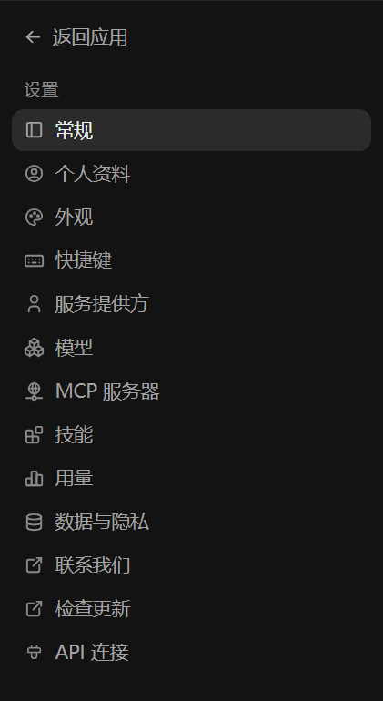

# Carb 5.6.13 · Windows x64

Release 发布时间（北京时间 UTC+8）：**以 GitHub Release 页面时间为准**。

Carb 是面向 AI 新手的桌面 AI 工作台，支持连接 API／CLI 模型、打开本地项目、处理文件、检查变更、使用终端并按任务扩展技能。

[下载 Windows 安装包](https://github.com/HIUPAC/Carb/releases/download/v5.6.13/Carb-Setup-5.6.13-win-x64.exe) · [下载完整便携包](https://github.com/HIUPAC/Carb/releases/download/v5.6.13/Carb-5.6.13-win-x64-portable.zip) · [完整修改日志](https://github.com/HIUPAC/Carb/blob/v5.6.13/CHANGELOG.md) · [使用说明](https://github.com/HIUPAC/Carb/blob/v5.6.13/README.md)

## 本版新增

在「设置」左侧新增以下按钮，点击后直接使用系统默认浏览器打开网页：

| 按钮 | 目标网页 | 行为 |
| --- | --- | --- |
| 联系我们 | [https://houpac.top/](https://houpac.top/) | 打开联系页面 |
| 检查更新 | [https://github.com/HIUPAC/Carb/releases](https://github.com/HIUPAC/Carb/releases) | 打开发行页面，查看版本说明和下载文件 |

两个按钮都作为直接打开网页的操作，支持中文、日文、英文；打开失败时会显示网页地址。「检查更新」不会自动下载或安装软件。

仓库与官网的软件下载安装入口统一指向 GitHub Releases。版本记录说明每次修改；下载表列出每个附件的上传与更新时间（北京时间 UTC+8）。官网提供最新 Release 及全部版本入口。



## 下载文件

| 文件 | 用途 | 大小 | 文件上传时间（北京时间 UTC+8） | 文件更新时间（北京时间 UTC+8） |
| --- | --- | --- | --- | --- |
| [Carb-Setup-5.6.13-win-x64.exe](https://github.com/HIUPAC/Carb/releases/download/v5.6.13/Carb-Setup-5.6.13-win-x64.exe) | Windows x64 当前用户安装版，默认安装到 `%LocalAppData%\Programs\Carb` | 163,305,830 字节，约 155.74 MiB | 2026-11-17 13:26:35 | 2026-11-17 13:30:17 |
| [Carb-Setup-5.6.13-win-x64.exe.sha256](https://github.com/HIUPAC/Carb/releases/download/v5.6.13/Carb-Setup-5.6.13-win-x64.exe.sha256) | 安装包 SHA-256 校验值 | 文本文件 | 2026-11-17 13:26:35 | 2026-11-17 13:26:35 |
| [Carb-Setup-5.6.13-win-x64.manifest.json](https://github.com/HIUPAC/Carb/releases/download/v5.6.13/Carb-Setup-5.6.13-win-x64.manifest.json) | 版本、签名状态与载荷文件摘要清单 | JSON 文件 | 2026-11-17 13:26:35 | 2026-11-17 13:26:45 |
| [Carb-5.6.13-win-x64-portable.zip](https://github.com/HIUPAC/Carb/releases/download/v5.6.13/Carb-5.6.13-win-x64-portable.zip) | 同版本完整运行载荷，解压后运行 `Carb-5.6.13/Carb.exe` | 211,864,824 字节，约 202.05 MiB | 2026-11-17 13:26:35 | 2026-11-17 13:30:40 |
| [Carb-5.6.13-win-x64-portable.zip.sha256](https://github.com/HIUPAC/Carb/releases/download/v5.6.13/Carb-5.6.13-win-x64-portable.zip.sha256) | 便携包 SHA-256 校验值 | 文本文件 | 2026-11-17 13:26:35 | 2026-11-17 13:26:35 |

时间按 GitHub Release 附件的 `created_at`（上传记录创建时间）和 `updated_at`（文件记录最后更新时间）换算为北京时间；大文件上传完成时间以 GitHub 返回记录为准。

完整运行载荷包含应用、Electron 运行时、原生依赖与所需资源。GitHub 自动生成的 **Source code** ZIP／tar.gz 只包含仓库文件，不能替代上表中的可运行软件。

## 文件校验

安装包 SHA-256：

```text
8fc61bcf3f6764ebfb41f0554e7a5c6cf160b1e1cf589a98eda497780d5121be
```

便携包 SHA-256：

```text
b7d38dc360e44ed97159c33aaa544db9d530f966b78b4d6e204bc1fb562b528f
```

在下载目录运行 PowerShell，将结果与本页或对应 `.sha256` 文件核对：

```powershell
Get-FileHash .\Carb-Setup-5.6.13-win-x64.exe -Algorithm SHA256
Get-FileHash .\Carb-5.6.13-win-x64-portable.zip -Algorithm SHA256
```

安装包和运行载荷未经数字签名。摘要用于核对文件一致性，下载来源请以 [HIUPAC/Carb Releases](https://github.com/HIUPAC/Carb/releases) 为准。

## 安装与更新

首次安装可运行 EXE，并按向导选择语言和安装目录；也可校验完整 ZIP 后解压运行。

从旧版更新时，先阅读本版说明并备份重要项目、配置和实际使用的 Carb 数据目录；退出 Carb 后运行新版安装向导，无需先卸载旧版。窗口关闭后仍驻留托盘时，请从托盘菜单退出。便携版应解压至新目录后运行；它仍使用默认用户资料目录，并非完全自包含的用户资料模式。

**卸载安装版会永久删除默认本地设置、会话、凭据和缓存。** 卸载前请备份。完整步骤见 [README 的更新与卸载说明](https://github.com/HIUPAC/Carb/blob/v5.6.13/README.md#更新与卸载)。

## 发布范围与许可

本次发布 Windows x64 5.6.13；API／CLI 服务、额度和任务工具需要用户另行配置。内置技能提供工作流程与工具指导，软件不附带通用大模型。

仓库同步 5.6.13 的发布 JavaScript／资源快照、当前维护工具、10 个内置技能、安装器及随包许可材料。`app/` 不是完整原始 TypeScript／TSX 工程；完整 Electron 运行时和原生依赖按 Release 提供。

主程序继承 Apache-2.0 并保留 TasteCode NOTICE；第三方组件、字体、技能和商业 SDK 遵循各自条款。详情见 [README](https://github.com/HIUPAC/Carb/blob/v5.6.13/README.md#开源许可证与第三方条款) 与 [许可说明](https://github.com/HIUPAC/Carb/blob/v5.6.13/docs/LICENSING.md)。

## 已完成的验证

- 在 5.6.13 实际设置界面验证「联系我们」「检查更新」两个入口，未发现渲染错误。
- 核对安装包字节数、SHA-256、校验文件及发行 manifest。
- 完整便携包包含 14,041 个文件，已逐项对比运行载荷与安装器 manifest，并核对字节数和 SHA-256。

以上记录描述本次验证范围，不代表所有模型任务、完整安装流程或 Office 成果均已经验收。

## 版本记录

| 版本 | Release 发布时间（北京时间 UTC+8） | 该版本修改内容 | 安装包与完整便携包 |
| --- | --- | --- | --- |
| 5.6.13 | 以 GitHub Release 页面时间为准 | 设置新增「联系我们」「检查更新」，支持中／日／英与打开失败提示；更新发行快照与校验资料，统一 Release 下载入口并记录附件上传时间 | [全部附件](https://github.com/HIUPAC/Carb/releases/tag/v5.6.13) |
| 5.6.12 | 2026-11-17 11:55:16 | 首次在本仓库整理发布 Windows x64 安装包、完整便携包、维护快照与许可材料 | [全部附件](https://github.com/HIUPAC/Carb/releases/tag/v5.6.12) |

历史版本：[v5.6.12 Release](https://github.com/HIUPAC/Carb/releases/tag/v5.6.12) · [5.6.12 发行说明](https://github.com/HIUPAC/Carb/blob/v5.6.12/docs/RELEASE-v5.6.12.md) · [与上一版本的代码差异](https://github.com/HIUPAC/Carb/compare/v5.6.12...v5.6.13)。
